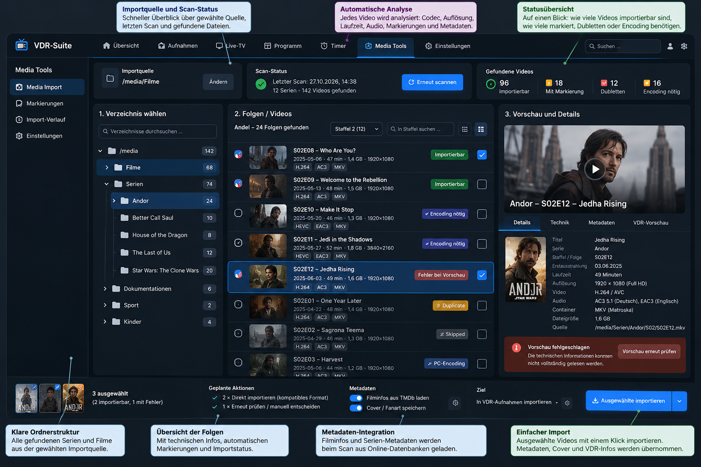

# VDR-Suite Media Tools

**Medien für VDR importieren, prüfen und bei Bedarf umkodieren – direkt in VDR-Suite.** Media Tools ergänzt die bestehende VDR-Suite um einen quellbewussten Dateiimport, technische Vorprüfungen, automatische Metadatenzuordnung und optionale Aufnahmeverkleinerung. **VDR bleibt Eigentümer seiner nativen Aufnahmen**, und ein Import gilt erst nach unabhängigem Aufnahme-Readback als erfolgreich.

[Zur VDR-Suite](../../README.md) · [Installation nach Distribution](README.install.md) · [Roadmap und Abnahmestand](ROADMAP.md)

## Einstieg

| Ich möchte … | Hier anfangen |
| --- | --- |
| Media Tools kennenlernen | [Funktionen und Oberfläche](#was-media-tools-bietet) |
| Media Tools auf **yaVDR/Ubuntu** installieren oder aktualisieren | [Installationsübersicht](README.install.md) und [yaVDR-Anleitung](../../docs/media-tools-installation.md) |
| Die Möglichkeiten unter **Debian, MLD 6.6 oder openSUSE** prüfen | [Distributionen und Portabilitätsstatus](README.install.md) |
| Eine **bestehende** Installation kontrolliert übernehmen oder aktualisieren | [Installer-/Updater-Handoff](INSTALLER-RESUME.md) |
| Den aktuellen Entwicklungs- und Teststand erfahren | [Konsolidierte Media-Tools-Roadmap](ROADMAP.md) |
| Quellcode, Tests und frühere technische Entscheidungen nachvollziehen | [Implementierungsnotizen](IMPLEMENTATION-NOTES.md) und [Installationsinventar](INSTALLATION-BASELINE.md) |

## Was Media Tools bietet

- **Media Import:** Zugelassene Importquellen einschließlich Unterordnern durchsuchen, nach Filmen und Serien filtern, Folgen auswählen und erst nach ausdrücklicher Bestätigung importieren.
- **Technische Vorschau:** Video-/Audioeigenschaften, lokale NFO-Informationen, Platzbedarf, Zielordner und Importfähigkeit aus dem tatsächlichen Backend anzeigen.
- **VDR-gerechter Import:** Geeignete Quellen möglichst ohne Video-Umkodierung übernehmen; native Aufnahme, Index und VDR-/Core-Readback vor einer Erfolgsmeldung verifizieren.
- **Serien, Episoden und Artwork:** Vorhandene lokale Metadaten und eine eindeutige automatische TMDb-Zuordnung nutzen; das Original muss für die Zuordnung nicht erneut importiert werden. Uneindeutige Treffer bleiben kenntlich.
- **Stapelimport:** Eine bestätigte Auswahl dauerhaft im Core reservieren und serverseitig fortsetzen. Der Browser ist Beobachter, nicht Auftragstreiber. Aufträge lassen sich nach erneuter Anmeldung wiederfinden.
- **Status statt Status-Polling:** Der laufende Import nutzt Core-Operationen und Ereignisse über SSE. Ein Reconnect liest den bestehenden Auftrag erneut, ohne ihn neu zu starten.
- **Rectools-kompatible Markierungen:** `.skipped`, `.pc_encode` und `.duplicate` bleiben als bestehende Dateistatus verständlich sichtbar. Eine nachweislich bereits vorhandene VDR-Aufnahme kann als Dublette erkannt werden; keine neue Aufnahme allein durch einen Scan.
- **Media Check und HEVC-Shrink:** Aufnahmen getrennt prüfen oder eine freigegebene Aufnahme optional verkleinern. Der vorhandene Shrink-Flow gehört zu den Aufnahmeaktionen, nicht zu einer zweiten Importengine.

**Nicht enthalten:** eine allgemeine VDR-Reparaturfunktion, ein beliebiger Dateisystem-Explorer, freie FFmpeg-Kommandozeilen aus dem Browser oder eine universelle automatisierte Installation auf jeder Distribution.

## Oberfläche



*Gestalterische Referenz, **kein Screenshot der aktuell installierten Oberfläche**. Die tatsächliche Desktop-/Handy-Parität wird in der [Roadmap](ROADMAP.md) separat abgenommen.*

Die Media-Import-Ansicht orientiert sich an drei Arbeitsbereichen: links **Quellen und Ordner**, mittig **Filme und Episoden**, rechts **Vorschau und Aktionen**. Auf kleinen Bildschirmen werden dieselben Inhalte als nacheinander zugängliche Ansichten dargestellt. Stapelauswahl und Status gehören zum jeweiligen Film beziehungsweise bestätigten Auftrag, nicht in ein separates technisches Formular.

### Typischer Ablauf

1. **Quelle öffnen:** Media Import zeigt die vom Backend angebotenen Ordner, Dateien und zuletzt bestätigten Zustände.
2. **Film oder Folge auswählen:** Die technische Vorschau prüft die konkrete Quelldatei lesend. Bereits vorhandene Aufnahmen und Rectools-Marker bleiben unterscheidbar.
3. **Metadaten verwenden:** Lokale NFO-Informationen und – wenn eindeutig vorhanden – die bereits gefundene TMDb-Identität werden vor dem Import gebunden. Eine manuelle TMDb-Wahl ist nicht der normale Pflichtschritt.
4. **Import bestätigen:** Direktimport ist der Standard, soweit technisch möglich. Eine nötige H.264-Umkodierung wird ausdrücklich ausgewählt; `.pc_encode` kann eine externe Bearbeitung kennzeichnen.
5. **Ergebnis sehen:** VDR-Aufnahme, native `info`, Index, Core-Status und danach die Aufnahmeübersicht werden über die bestehenden Produktwege nachgeführt. Ein ungewisser Auftrag ist keine Aufforderung zum blind wiederholten Import.

## Architektur

```text
VDR-Suite Webfrontend / spätere TV-Clients
           |
           v
Authenticated Public API v1 + Operation-SSE
           |
           v
Suite Core: Berechtigungen, dauerhafte Aufträge,
           Metadatenbindung, VDR-Aufnahme-Readback
           |
           v
Bestehender Backend-Agent: Quellinventar, Vorschau,
           genehmigte Worker-Ausführung
           |
           v
Media-Tools-Worker: Import / Check / HEVC-Shrink
           |
           v
VDR-native .rec-Aufnahme / info / index / Recording-Cache
```

Media Tools arbeitet **innerhalb** der VDR-Suite-Architektur. Der Core besitzt die dauerhafte Auftragsidentität und bestätigt den tatsächlichen Aufnahmezustand. Die Worker werden über die vorhandenen Agent-/Freigabewege ausgeführt; reine Lesefunktionen dürfen keine Mutation oder einen Import auslösen. Das Add-on hat keine eigene zweite Auftragsdatenbank.

## Installation und Distributionen

Die [distributionsbezogene Installations-README](README.install.md) führt zu bestehenden Anleitungen für **yaVDR/Ubuntu**, **Debian/Ubuntu-Pakete**, **MLD 6.6** und **openSUSE**. Die [portable Staging-Anleitung](../../docs/media-tools-portable-install.md) beschreibt den gemeinsamen geprüften Add-on-Payload.

**Wichtig:** Erfolgreicher Import auf yaVDR bedeutet nicht automatisch, dass ein neues MLD-/openSUSE-Paket oder eine Migration einer vorhandenen Installation bereits abgenommen wurde. Installationsart, Dienstnutzer, VDR-ABI, Werkzeuge und reale Verzeichnisse werden pro Host geprüft. Installation erteilt keine zusätzlichen Benutzerrechte und startet keine Medienaufträge.

## Entwicklungsstand – 11. November 2026

Die [Media-Tools-Roadmap](ROADMAP.md) hält die Einzelheiten und Nachweisgrenzen fest. Die wichtigsten Punkte:

| Bereich | Stand |
| --- | --- |
| **H.264-Import und HEVC-Direktimport über Core/Agent** | Reale, abgegrenzte yaVDR-Readbacks **PASS** |
| **HEVC-Aufnahme im Android-Webplayer** | Bild/Ton und durchgängige Wiedergabe **PASS**; aktueller Seek-Fix nach wiederhergestelltem Produktionsbundle vom Maintainer **PASS** gemeldet |
| **Browserunabhängiger Sammelimport (MT.EVENT5)** | Implementiert und durch Maintainer als **erfolgreich getestet** bestätigt |
| **Operation-SSE und Langläufer (MT.EVENT2–4)** | Integriert und durch Maintainer als **erfolgreich getestet** bestätigt |
| **Metadaten (MT.META6)** | Produktcode integriert; echter yaVDR-Native-`info`-Readback vom 11.11.: **50/50** `.rec`-Aufnahmen lesbar und mit `00001.ts`/`index`; **26/26 Foundation** und **22/24 Andor** mit konsistentem nativen `T`-Serientitel. Nur die alten Andor-Folgen S01E01/S01E02 haben trotz korrekter `S`/`D` noch den ursprünglichen Dateinamen als `T`; gezielte Altbestandskorrektur offen |
| **Scan, responsive UI, Marker, Import-/Batch-Ansichten** | Implementiert; die abschließende Gesamt-/Mockup-Abnahme ist separat zu bewerten |
| **Encoding-Konfiguration** | Typisierte Backend-Werte vorhanden; komfortable Web-Einstellungsseite noch nicht implementiert |
| **MLD/openSUSE und Release-Paketmigration** | Portabilitäts-/Staging-Arbeit vorhanden; reale distributionsspezifische Media-Tools-Abnahme offen |

**Bei den beiden vom Maintainer bestätigten Tests werden keine neuen Nachweistests allein wegen alter Roadmap-Texte angesetzt.** Eine genaue Runtime-Version, Testdauer oder ein bestimmtes Unter-Szenario ist durch die bloße Statusbestätigung nicht zusätzlich belegt.

## Für Entwickler

- **Quellen:** `addons/media-tools/{include,src,tests}`; Suite-eigene Integration unter `core/addons/media-tools/`, `core/agent/`, `api/rest/` und `web/frontend/`.
- **API:** [VDR-Suite Public API](../../api/README.md).
- **Bestehende gezielte Tests:** `make test-addon-media-import`, `make test-addon-media-shrink` sowie `node web/frontend/tests/test_media_import_composition.js`. Welche davon für eine Codeänderung erforderlich sind, hängt vom geänderten Teil ab.
- **Technische Referenz:** Die bisherige ausführliche README ist ohne inhaltliche Kürzung unter [IMPLEMENTATION-NOTES.md](IMPLEMENTATION-NOTES.md) archiviert.
- **Projektregeln:** [Repository-AGENTS.md](../../AGENTS.md) und [Add-on-AGENTS.md](AGENTS.md). Die Regeln sind keine Voraussetzung, um die Dokumentation zu lesen.

## Projektstatus und Lizenz

Die [Media-Tools-Roadmap](ROADMAP.md) führt die aktuelle lokale Statusübersicht mit historischen Implementierungsprotokollen. Der übergreifende operative VDR-Suite-Status steht in [CURRENT.md](../../docs/CURRENT.md); für reale Installationen gilt weiterhin der separat geprüfte Runtime-Stand. Nach Abschluss von Media Tools ist [Backend-Agent Simplification (BAS)](ROADMAP.md) als eigenständige nächste Wartungsphase vorgesehen, nicht bereits gestartet.

Für Lizenz und Rechteklärung des VDR-Suite-Codes gelten [LICENSE](../../LICENSE) und die [Provenienz-/GPL-Dokumentation](../../docs/gplv3-compatibility-audit.md).
